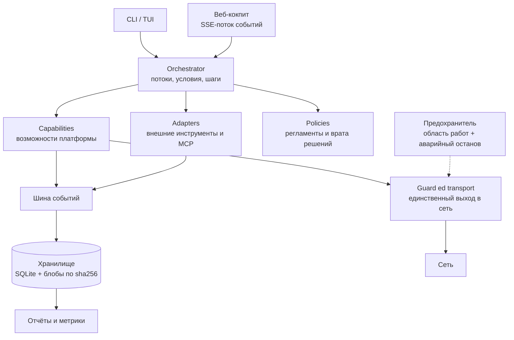

# Химера — платформа автоматизации работ по безопасности

> Витрина архитектуры. Полный исходный код приватный — доступ по запросу на техническом созвоне.
> Здесь только инженерные решения, схема слоёв и цифры. Боевых возможностей, техник и данных целей нет.

**Химера** — платформа, которая превращает набор разрозненных консольных инструментов в единый управляемый контур: одна шина событий, одно хранилище доказательств, единый отчёт и жёсткие границы допустимых действий.

Проект написан на Python 3.10 без тяжёлых зависимостей: `pydantic`, `pyyaml`, `rich`, `mitmproxy`. Ядро намеренно стерильно — в нём нет ни numpy, ни torch, ни моделей: вся математика решений живёт на стандартной библиотеке, а внешние инструменты подключаются отдельными процессами.

## Цифры

| Параметр | Значение |
|---|---|
| Строк Python | **96 228** |
| Модулей | **323** |
| Автотестов в наборе | **2 283** |
| Тестовых файлов | 173 |
| Миграций схемы БД | 13 |
| Коммитов | 99 |
| Внешних зависимостей ядра | 5 |

## Что решает платформа

1. **Единый конвейер вместо зоопарка инструментов.** Внешние CLI описываются манифестом (что запускать, как читать вывод, какие коды считать успехом) и ставятся на общую шину событий.
2. **Доказательство, а не мнение.** Каждая находка обязана иметь сырьё, сохранённое по sha256. Хэш считает хранилище, а не автор находки — подменить доказательство нельзя, а подмена ловится при чтении.
3. **Границы, которые нельзя обойти случайно.** Область работ объявляет разрешённые цели и ступень допустимого воздействия; предохранитель стоит перед каждым сетевым вызовом, а аварийный останов одним файлом-флагом гасит всю платформу.
4. **Вердикт по правилам, а не по вкусу.** Подтверждение принимается двумя независимыми путями: согласием двух разборов либо воспроизводимым доказательством. Нет ни одного — находка остаётся неподтверждённой, и причина называется явно.
5. **Отчёт из базы, а не из памяти прогона.** Отчёт и метрики собираются запросами к хранилищу, поэтому не могут разойтись с тем, что реально записано.

## Архитектура

Слои разделены контрактными тестами: ядро не имеет права импортировать адаптеры, транспорт, CLI и сетевые библиотеки; адаптер не имеет права лезть в хранилище напрямую. Новый импорт в ядре — красная сборка, а не «потом разберёмся».

## Слои

| Слой | Строк | Файлов | Ответственность |
|---|---|---|---|
| `core` | 9 794 | 42 | шина, хранилище, схема, область работ, предохранитель |
| `capabilities` | 8 773 | 25 | возможности платформы: разбор, проверка, сбор доказательств |
| `policies` | 12 224 | 29 | регламенты и решатели: вердикты, отсев, регрессия |
| `adapters` | 3 051 | 8 | манифесты и запуск внешних инструментов, источник MCP |
| `web` | 3 151 | 9 | кокпит: маршруты, поток событий, действия оператора |
| `reports` | 3 381 | 11 | отчёты смены, метрики, покрытие |
| `cli` | 10 704 | 5 | команды и их проверки |
| `orchestrator` | 786 | 4 | потоки работ: зависимости, условия, шаги |
| `transport` | 1 090 | 8 | единственный выход в сеть под предохранителем |
| `net` | 1 600 | 7 | сетевые помощники вне ядра |
| `tests` | 41 659 | 173 | 2 283 испытания |

Тестов больше, чем кода: 41 659 строк испытаний против 54 569 строк продукта.

## Инженерные решения, которыми я горжусь

- **Схема находки заморожена.** 21 скаляр плюс версия, `extra="forbid"`, `frozen=True`. Любая правка состава — только миграцией с поднятием версии. Это дороже в моменте и спасает базу потом.
- **Границы слоёв проверяются разбором AST**, а не договорённостью. Монолит не прорастает, потому что сборка краснеет.
- **Доказательство проверяется при чтении.** Хранилище сверяет sha256 с содержимым и поднимает ошибку целостности; есть надзор по всему хранилищу.
- **Два пути вердикта, третий — отказ.** Подтверждение принимается согласием двух независимых разборов либо воспроизводимым доказательством; иначе находка честно остаётся неподтверждённой.
- **Аварийный останов старше всего.** Файл-флаг отменяет любую работу, включая уже разрешённую; проверяется живым испытанием.
- **Изъян шага не выдаётся за успех.** Инструмент, снятый извне или сорвавшийся, помечается как «с изъяном» и пишется в базу — иначе отчёт врёт.
- **Регламент — данные, решатель — чистый код.** Пороги живут в правилах, а не в коде: правка регламента меняет вердикт без строки кода и обязана краснеть в регрессии на золотом корпусе.
- **Стерильное ядро.** Никакой математики через тяжёлые библиотеки: то, что нужно, живёт на стандартной библиотеке или в отдельном процессе.

## Что показывает проект как портфолио

- Проектирование системы с жёсткими границами слоёв и контрактами, а не «набор скриптов».
- Дисциплина доказательств: каждая запись проверяема, каждая подмена ловится.
- Миграции и обратная совместимость на живом проекте (13 версий схемы).
- Тесты как основной инструмент проектирования: 2 283 испытания, контрактные и живые.
- Работа с чужими инструментами: манифесты, изоляция окружений, разбор вывода, честные коды возврата.
- Оркестрация длинных процессов: зависимости, условия, повторы, откаты, отчёты из базы.

## Чего здесь нет и почему

- **Нет исходного кода.** Платформа содержит боевые возможности; публиковать их — риск для всех, кто ими пользуется.
- **Нет техник и правил.** Библиотека техник и регламенты живут в приватном репозитории.
- **Нет данных целей, адресов и артефактов прогонов.** Всё это остаётся в приватном контуре.

## Стек

Python 3.10 · pydantic · SQLite (WAL) · starlette + uvicorn · mitmproxy · rich · pytest

---

Автор: Михаил Соболев · [GitHub](https://github.com/xemool777-cmyk)
Связь: xemooll77@mail.ru
