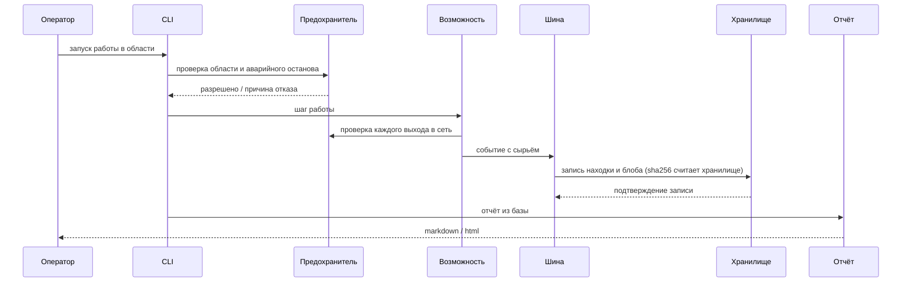

# Архитектура Химеры

> Документ описывает устройство платформы на уровне слоёв и контрактов. Реализация приватная.

## Принцип: слои с запретами, а не с пожеланиями

Платформа разделена на слои, и каждый запрет проверяется автоматически — контрактным тестом, который разбирает AST импортов.

| Слой | Может | Не имеет права |
|---|---|---|
| `core` | хранить, публиковать события, проверять область работ | импортировать адаптеры, транспорт, CLI, сетевые библиотеки |
| `adapters` | запускать внешние инструменты, разбирать их вывод | обращаться к хранилищу напрямую |
| `capabilities` | выполнять возможности платформы и публиковать события | писать в базу в обход хранилища |
| `policies` | решать по регламенту, без сети | ходить в сеть, знать про транспорт |
| `web`, `cli`, `reports` | читать и показывать | менять состояние в обход хранилища |
| `transport` | единственный выход в сеть | обходиться без предохранителя |

Нарушение любого запрета — красная сборка. Так система не превращается в монолит, даже если над ней работают параллельно.

## Поток одной работы

Ключевое: **отчёт не знает, что было в памяти прогона**. Он собирается запросами к хранилищу, поэтому цифры в отчёте всегда совпадают с базой.

## Хранилище

- SQLite в режиме WAL, миграции пронумерованы и применяются по порядку (13 версий).
- Блобы доказательств лежат отдельно, адресуются sha256, проверяются при чтении.
- Схема первой сущности заморожена: правка состава полей — только миграцией и поднятием версии.
- Каждая новая сущность получает свою таблицу, свой контракт столбцов и своё испытание против `PRAGMA table_info`.

## Шина событий

Закрытый словарь видов событий: новый вид добавляется явно, а не «как получится». Подписчик хранилища разбирает событие и записывает:

1. описание сущности;
2. содержимое как блоб;
3. хэш, посчитанный хранилищем, а не автором.

Правило «хэш считает хранилище» закрывает целый класс подмены: автор находки не может подсунуть свой хэш в отчёт.

## Область работ и предохранитель

Область работ — декларативный файл: какие цели разрешены, какая ступень воздействия допустима, какой темп запросов, какие окна времени.

Предохранитель — чистая функция без сети, порядок проверок фиксирован:

1. аварийный останов;
2. окно времени;
3. режим сухого прогона;
4. порт;
5. хост;
6. путь и метод.

Отказ возвращает причину словами, а не голый код. Это важно для оператора: «запрещено» без причины не читается.

## Кокпит

Веб-слой поднимается на петле, закрыт токеном, отдаёт состояние и поток событий через SSE. Сетка: дерево целей, поток находок, разбор выбранной.

Действия оператора (подтвердить, пометить ложной, поставить вердикт) идут через отдельный слой действий, а не через прямую запись в базу.

## Отчёты

Отчёт смены и метрики — рендереры поверх хранилища, а не накопители. Одна форма, две одёжки: markdown и html. Метрики считают распределения находок, вердиктов и времени смены.

## Почему так

Каждое решение принято после конкретной поломки:

- границы слоёв появились после того, как ядро начало тянуть транспорт;
- заморозка схемы — после первой правки полей «на живую»;
- «хэш считает хранилище» — после попытки автора находки записать свой хэш;
- статус «с изъяном» — после шага, который записался успешным при снятом извне инструменте;
- два пути вердикта — после того, как «подтверждено» получалось без второго голоса.

Это и есть инженерная часть: не «так красиво», а «так перестало ломаться».
